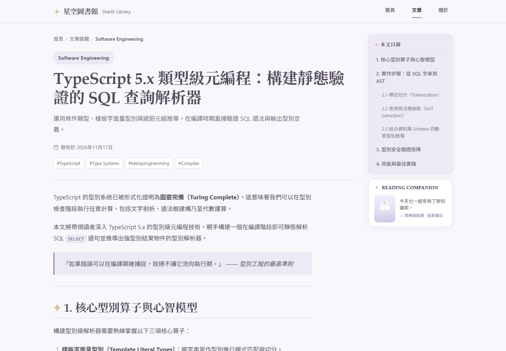
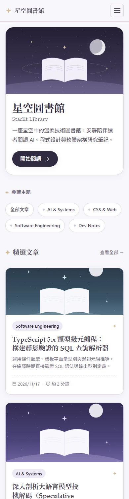
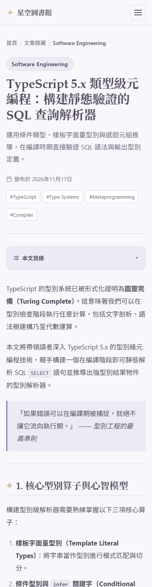

# Starlit Library Theme

**English** | [繁體中文](README.zh-TW.md)

A calm, reading-first [Astro](https://astro.build) blog theme for long-form technical writing: a quiet starlit-library mood, a clear reading rhythm, and an optional little mascot you can switch off.

## Preview

**Live demo:** <https://starlit-library-theme.pages.dev>

| Home | Article |
|---|---|
|  |  |

| Home (mobile) | Article (mobile) |
|---|---|
|  |  |

> Screenshots show the theme's default content (neutral placeholder artwork and sample posts). The sample posts and interface text are in Traditional Chinese; see [Interface text and language](#interface-text-and-language) to change that.

## Features

- Home page: hero banner, featured posts, latest notes, topic chips, mascot corner
- Article page: table of contents, previous / next links, reading time, mobile-friendly code blocks and tables
- Article list with category filtering
- About page written in plain Markdown (`src/content/pages/about.md`)
- RSS (`/rss.xml`), Open Graph / canonical meta, 404 page
- Images are converted to WebP in several sizes automatically (built into Astro, no extra packages)
- Mobile navigation drawer, visible keyboard focus styles, `prefers-reduced-motion` support
- No front-end UI framework: plain Astro components and CSS

## Quick start

Requires Node.js `>= 22.23.4` (an Astro 7 requirement).

```sh
git clone https://github.com/hakuei0115/Starlit-Library-Theme.git my-blog
cd my-blog
npm install
npm run dev        # http://localhost:4321
```

Other commands:

| Command | Purpose |
|---|---|
| `npm run dev` | Start the dev server |
| `npm run build` | Build to `dist/` |
| `npm run preview` | Preview the production build |
| `npx astro check` | Type check |

> `.github/` (CI and Dependabot configuration) comes along when you clone. Delete it if you don't need it.

## Configuration

Everything that is specific to *your* site lives in [`src/site.config.ts`](src/site.config.ts):

| Section | What it controls |
|---|---|
| `title` / `subtitle` / `description` | Site name, tagline, default meta description |
| `lang` | HTML `lang` attribute and date format (default `zh-TW`) |
| `author` | Name in the footer copyright line |
| `nav` | Navigation items (label, secondary label, link) |
| `links` | Footer GitHub and RSS links (`github: ''` hides the GitHub link) |
| `footer` | Footer tagline and note |
| `hero` | Hero copy, button, banner alt text |
| `mascot` | Mascot name and every line it says; `enabled: false` removes it entirely |
| `notFound` / `articles` | Copy for the 404 page and the article list page |
| `art` | Hero banner, mascot and social share images |
| `covers` | Category-to-cover mapping and the default cover |

You also need to tell the theme your production URL. Canonical links, Open Graph images and the RSS feed all depend on it, and `astro build` prints a warning if it is missing.

The easiest way is the `SITE_URL` environment variable, which [`astro.config.mjs`](astro.config.mjs) reads. Set it in your host's settings, or when building:

```sh
SITE_URL=https://example.com npm run build
```

If you prefer a fixed value, replace the `site` line in `astro.config.mjs` instead:

```js
export default defineConfig({
  site: 'https://example.com',
});
```

### Interface text and language

Section headings (for example "Featured" and "Latest notes") are currently written directly in the components and default to Traditional Chinese. To change the language, search for and edit the strings in `src/components/` and `src/pages/`. Text covered by `site.config.ts` (site name, navigation, hero, footer, mascot lines, 404) is changed there, and `lang` sets the HTML `lang` attribute and date formatting.

## Writing posts

Posts live in `src/content/blog/`, one `.md` (or `.mdx`) file per post. The file name becomes the URL (`/posts/<file-name>/`).

```md
---
title: "Post title"
description: "One or two sentences (used on cards, in meta tags and in RSS)"
pubDate: 2026-11-15
category: "Dev Notes"
tags: ["Astro", "Notes"]
featured: false      # true shows it in the home page "Featured" section
draft: false         # true keeps it unpublished
# updatedDate: 2026-11-20
# heroImage: "/images/my-cover.jpg"   # custom cover (placed under public/)
---

Content...
```

| Field | Required | Description |
|---|---|---|
| `title` | ✓ | Title |
| `description` | ✓ | Summary |
| `pubDate` | ✓ | Publication date |
| `category` | ✓ | Category (a single value) |
| `tags` | | Array of tags |
| `featured` | | Show in the home page featured section |
| `draft` | | Drafts are not published |
| `updatedDate` | | Last updated date |
| `heroImage` | | Cover image path for this post only |

## Images and covers

**All bundled images are neutral placeholders** (`src/assets/brand/`, SVG). There are two ways to replace them with your own:

1. **Overwrite the files:** put your images in `src/assets/brand/` (as `.png`, `.jpg` or `.webp`) and update the `import` paths at the top of `src/site.config.ts` to match.
2. **Add new images and import them in the config:** import the new image in `site.config.ts`, then assign it to `art` or `covers`.

Recommended sizes:

| Use | Ratio / size |
|---|---|
| `art.heroBanner` | About 2.4:1 (e.g. 1942×809) |
| `art.heroBannerMobile` | 16:9 (e.g. 1672×941), optional |
| `art.mascot` | 3:4 portrait (e.g. 1086×1448) |
| Category covers | About 3:2 (e.g. 1536×1024) |
| `art.ogImage` | 1200×630, optional (the hero banner is cropped when unset) |

A post's cover is chosen in this order: **the post's `heroImage` front matter → `covers.byCategory[category]` → `covers.defaultCover`**. Categories not listed in `byCategory` fall back to the default cover, so adding a category never requires changes elsewhere.

```ts
// src/site.config.ts
import myCover from './assets/brand/covers/my-notes.jpg';

covers: {
  defaultCover: coverDefault,
  byCategory: {
    'My Category': myCover,
  },
},
```

Every image loaded through the config (SVG, PNG, JPG) is converted to WebP in several sizes automatically.

> The placeholders are SVG, so `astro.config.mjs` enables `image.dangerouslyProcessSVG`. Only use that option for SVGs that live in your own project and that you trust.

## Markdown

Posts are rendered with the remark pipeline plus [`remark-cjk-friendly`](https://github.com/tats-u/markdown-cjk-friendly), so bold and italic work next to Chinese, Japanese and Korean punctuation. Add other remark or rehype plugins to `markdown.processor` in `astro.config.mjs`.

## Mascot (the librarian)

The theme includes an optional small mascot (by default, a librarian): the corner card on the home page, the reading companion beside articles, and the illustrations on the 404 page and empty states. Its name, lines and image are set in `mascot` and `art.mascot` in `site.config.ts`.

Don't want it? Set `mascot.enabled: false` and every related element, including the home page layout, adjusts automatically.

## About page

Edit [`src/content/pages/about.md`](src/content/pages/about.md). The front matter at the top controls the title, description and eyebrow label; everything below it is ordinary Markdown.

## Deployment

This is a fully static site. `npm run build` writes the output to `dist/`.

On any static host (Cloudflare Pages, Vercel, Netlify, GitHub Pages and so on):

- Build command: `npm run build`. Output directory: `dist`.
- The host's Node.js version must be `>= 22.23.4` (set it in the host's settings, for example with a `NODE_VERSION` environment variable).
- Set the `SITE_URL` environment variable to your production URL (or set `site` in `astro.config.mjs`) before deploying.
- GitHub Pages project sites need `base` to be configured separately.

## Project structure

```text
src/
├── site.config.ts       # Site settings (edit this)
├── content/
│   ├── blog/            # Posts
│   └── pages/about.md   # About page
├── assets/brand/        # Placeholder images (replace with your own)
├── components/          # blog / home / layout / mascot / common
├── layouts/
├── pages/               # Routes: home, articles, about, 404, RSS
├── styles/              # tokens.css (design variables), global.css
└── utils/posts.ts       # Post filtering, featured posts, reading time, cover selection
```

Colors, spacing and radii are all defined in `src/styles/tokens.css`. Start there if you want to change the theme colors.

## License

The code is released under the [MIT License](LICENSE).

The images bundled with the theme are neutral placeholders you may use or replace freely. **The theme author's character artwork is not part of this repository and is not covered by this license.**
