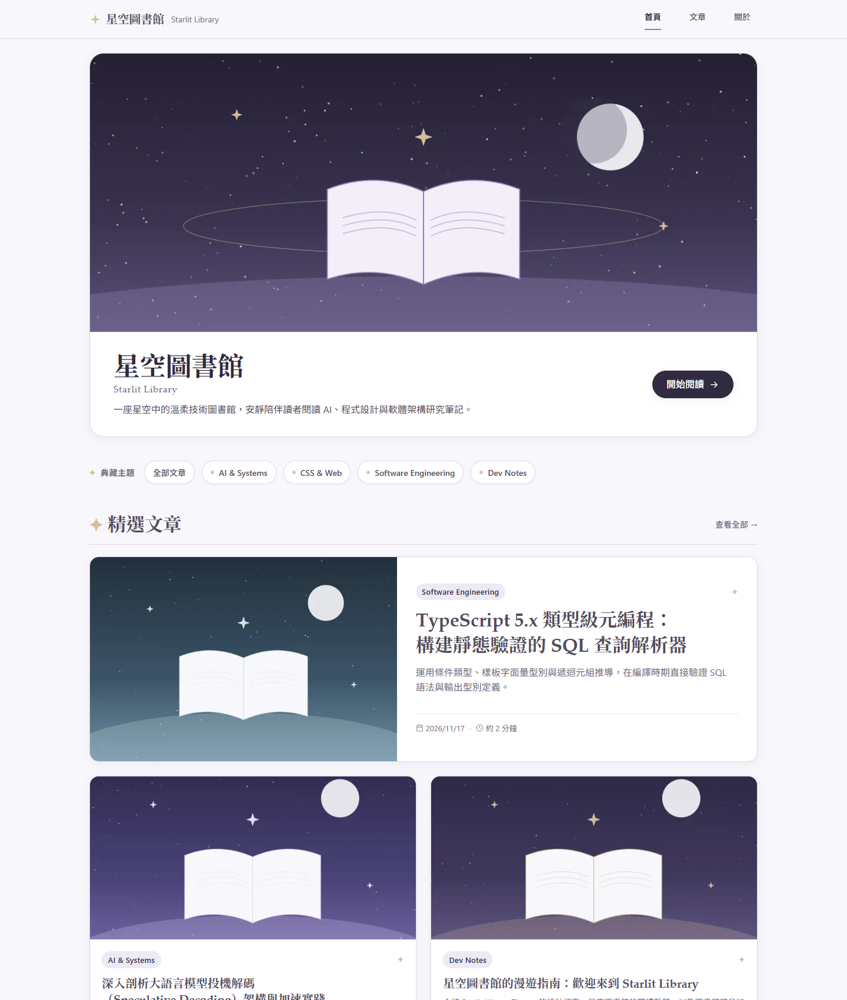
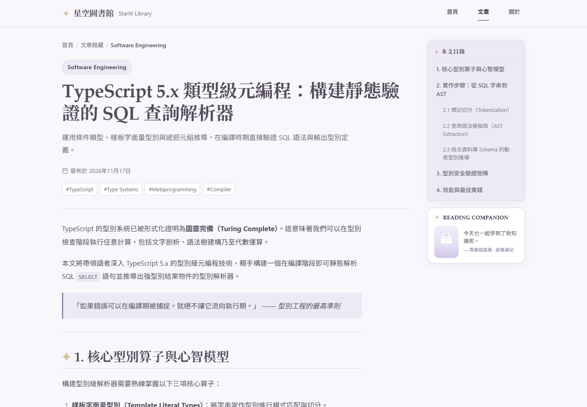
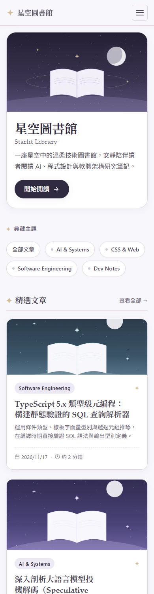
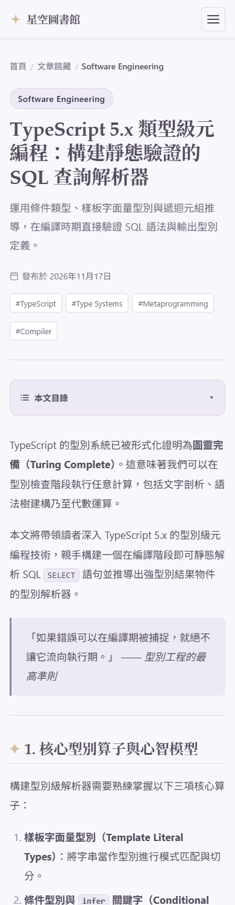

# Starlit Library Theme

一套為「長文閱讀」設計的 [Astro](https://astro.build) 技術部落格主題：安靜的星空氛圍、清楚的閱讀節奏，以及一位可以開關的小吉祥物。

A calm, reading-first Astro blog theme with a starlit-library mood and an optional mascot.

[English](README.md) | **繁體中文**

## 預覽

**線上 Demo：** <https://starlit-library-theme.pages.dev>

| 首頁 | 文章頁 |
|---|---|
|  |  |

| 首頁（手機） | 文章頁（手機） |
|---|---|
|  |  |

> 截圖為主題預設內容（含中性佔位圖與範例文章）。

## 特色

- 首頁：Hero 橫幅、精選文章、最新筆記、主題分類、吉祥物角落
- 文章頁：目錄（TOC）、上一篇／下一篇、閱讀時間、程式碼區塊（含複製按鈕）與表格的行動版處理
- 文章列表：分類篩選
- 關於頁：直接用 Markdown 寫（`src/content/pages/about.md`）
- RSS（`/rss.xml`）、sitemap 與 `robots.txt`、canonical、Open Graph、Twitter 卡片與文章結構化資料（JSON-LD）、404 頁
- 圖片自動轉成 WebP 並依版位出多種尺寸（Astro 內建，不需額外套件）
- 行動版導覽抽屜、鍵盤焦點樣式、`prefers-reduced-motion` 支援
- 沒有任何前端 UI 框架：純 Astro 元件與 CSS

## 快速開始

需要 Node.js `>= 22.23.4`（Astro 7 的要求）。

```sh
git clone https://github.com/hakuei0115/Starlit-Library-Theme.git my-blog
cd my-blog
npm install
npm run dev        # http://localhost:4321
```

其他指令：

| 指令 | 用途 |
|---|---|
| `npm run dev` | 開發伺服器 |
| `npm run build` | 建置到 `dist/` |
| `npm run preview` | 預覽建置結果 |
| `npx astro check` | 型別檢查 |

> clone 後 `.github/`（CI、Dependabot、issue 與 PR 模板）和 `CONTRIBUTING.md` 會一起帶走，不需要的話可以直接刪除。

## 設定

所有「屬於你的網站」的資訊都集中在 [`src/site.config.ts`](src/site.config.ts)：

| 區塊 | 內容 |
|---|---|
| `title` / `subtitle` / `description` | 站名、副標、預設 meta 描述 |
| `lang` | HTML `lang` 與日期格式（預設 `zh-TW`） |
| `author` | 頁尾版權與文章結構化資料的作者名稱 |
| `nav` | 導覽項目（標籤、英文小標、連結） |
| `links` | 頁尾的 GitHub、RSS 連結（`github: ''` 可隱藏） |
| `footer` | 頁尾說明與備註 |
| `hero` | Hero 文案、按鈕、橫幅替代文字 |
| `mascot` | 吉祥物的名字與所有台詞；`enabled: false` 會整個移除 |
| `notFound` / `articles` | 404 頁與文章列表頁的文案 |
| `art` | Hero 橫幅、吉祥物與社群分享圖 |
| `covers` | 分類封面對應與預設封面 |

你還需要告訴主題你的正式網址。canonical 連結、Open Graph 圖片、RSS 與 sitemap（`/sitemap-index.xml`）都會用到它，沒設的話 `astro build` 會印出警告。

最簡單的方式是設環境變數 `SITE_URL`，[`astro.config.mjs`](astro.config.mjs) 會讀取它。可以設在主機的設定裡，或建置時指定：

```sh
SITE_URL=https://example.com npm run build
```

如果想直接寫死，改成修改 `astro.config.mjs` 裡的 `site` 那一行：

```js
export default defineConfig({
  site: 'https://example.com',
});
```

### 文字語言

各區塊的小標題（例如「精選文章」「最新筆記」）目前直接寫在元件裡，預設為繁體中文。要換語言，請搜尋並修改 `src/components/` 與 `src/pages/` 裡的字串。

## 寫文章

文章放在 `src/content/blog/`，一篇一個 `.md`（或 `.mdx`）檔，檔名就是網址（`/posts/<檔名>/`）。

```md
---
title: "文章標題"
description: "一兩句話的摘要（用在卡片、meta 與 RSS）"
pubDate: 2026-11-15
category: "Dev Notes"
tags: ["Astro", "Notes"]
featured: false      # true 會出現在首頁「精選文章」
draft: false         # true 不會發布
# updatedDate: 2026-11-20
# heroImage: "/images/my-cover.jpg"   # 自訂封面（放在 public/ 下）
---

內文……
```

| 欄位 | 必填 | 說明 |
|---|---|---|
| `title` | ✓ | 標題 |
| `description` | ✓ | 摘要 |
| `pubDate` | ✓ | 發布日期 |
| `category` | ✓ | 分類（單一值） |
| `tags` | | 標籤陣列 |
| `featured` | | 首頁精選 |
| `draft` | | 草稿不發布 |
| `updatedDate` | | 更新日期 |
| `heroImage` | | 這篇文章專屬的封面路徑 |

## 圖片與封面

**內建的圖片都是中性的佔位圖**（`src/assets/brand/`，SVG）。換成你自己的圖有兩種方式：

1. **覆蓋同名檔案：** 把你的圖放進 `src/assets/brand/`，改成 `.png`／`.jpg`／`.webp` 後，同步修改 `src/site.config.ts` 最上方的 `import` 路徑。
2. **新增圖片後在設定檔 import：** 在 `site.config.ts` 匯入新圖，再指定給 `art` 或 `covers`。

建議尺寸：

| 用途 | 比例／尺寸 |
|---|---|
| `art.heroBanner` | 約 2.4:1（例如 1942×809） |
| `art.heroBannerMobile` | 16:9（例如 1672×941），選填 |
| `art.mascot` | 3:4 直式（例如 1086×1448） |
| 分類封面 | 約 3:2（例如 1536×1024） |
| `art.ogImage` | 1200×630，選填（未設定時裁切 Hero 橫幅） |

文章封面的選擇順序是：**文章 front matter 的 `heroImage` → `covers.byCategory[分類]` → `covers.defaultCover`**。沒有列在 `byCategory` 的分類會自動用預設封面，所以新增分類不需要改其他地方。

```ts
// src/site.config.ts
import myCover from './assets/brand/covers/my-notes.jpg';

covers: {
  defaultCover: coverDefault,
  byCategory: {
    'My Category': myCover,
  },
},
```

所有透過設定檔載入的圖片（SVG、PNG、JPG）都會自動轉成 WebP 並產生多種尺寸。

> 佔位圖是 SVG，因此 `astro.config.mjs` 開啟了 `image.dangerouslyProcessSVG`。這個選項只適用於你自己專案內、可信任的 SVG。

## Markdown

文章使用 remark 流程加上 [`remark-cjk-friendly`](https://github.com/tats-u/markdown-cjk-friendly)，讓粗體與斜體在中日韓標點旁也能正常運作。其他 remark／rehype 外掛可加在 `astro.config.mjs` 的 `markdown.processor`。

`.mdx` 檔透過 [`@astrojs/mdx`](https://docs.astro.build/en/guides/integrations-guide/mdx/) 支援，並沿用上述設定。文章需要匯入元件時使用：

```mdx
import MyChart from '../../components/MyChart.astro';

<MyChart />
```

## 吉祥物（圖書館館員）

主題附一個可選的小吉祥物（預設是一位圖書館館員）：首頁的「角落」卡片、文章旁的陪讀卡片，以及 404 與空狀態的插圖。標題、台詞與圖片都在 `site.config.ts` 的 `mascot` 與 `art.mascot`。

不想要？設 `mascot.enabled: false`，所有相關元素（含首頁版面）都會自動調整。

## 關於頁

直接編輯 [`src/content/pages/about.md`](src/content/pages/about.md)。檔案最上方的 front matter 控制標題、說明與頁首小標；底下就是一般的 Markdown。

## 部署

這是純靜態網站，`npm run build` 會輸出到 `dist/`。

部署到任何靜態主機（Cloudflare Pages、Vercel、Netlify、GitHub Pages 等）時：

- Build command：`npm run build`，Output directory：`dist`。
- 主機的 Node.js 版本需為 `>= 22.23.4`（可在主機設定中指定，例如環境變數 `NODE_VERSION`）。
- 部署前先設好環境變數 `SITE_URL`（你的正式網址），或直接填進 `astro.config.mjs` 的 `site`。
- GitHub Pages 的專案頁面需要另外設定 `base`。

## 專案結構

```text
src/
├── site.config.ts       # 站台設定（改這裡）
├── content/
│   ├── blog/            # 文章
│   └── pages/about.md   # 關於頁
├── assets/brand/        # 佔位圖（換成你自己的）
├── components/          # blog / home / layout / mascot / common
├── layouts/
├── pages/               # 路由：首頁、文章、關於、404、RSS、robots.txt
├── styles/              # tokens.css（設計變數）、global.css
└── utils/posts.ts       # 文章篩選、精選、閱讀時間、封面選擇
```

視覺上的顏色、間距、圓角都集中在 `src/styles/tokens.css`，想換主題色從那裡開始。

## 參與貢獻

歡迎回報問題、提出想法或送 PR，請見 [CONTRIBUTING.md](CONTRIBUTING.md)（英文，issue 與 PR 可以用中文撰寫）。

## 授權

程式碼以 [MIT License](LICENSE) 授權。

主題附的圖片都是中性佔位圖，可自由使用或替換。**主題作者的角色美術不包含在這個 repository 中，也不在此授權範圍內。**
